# Running a Spark Application on Kubernetes

## Install Docker Desktop

```bash

cd ~/Downloads

wget -O docker-desktop-amd64.deb \
https://desktop.docker.com/linux/main/amd64/docker-desktop-amd64.deb

sudo apt install ./docker-desktop-amd64.deb

```

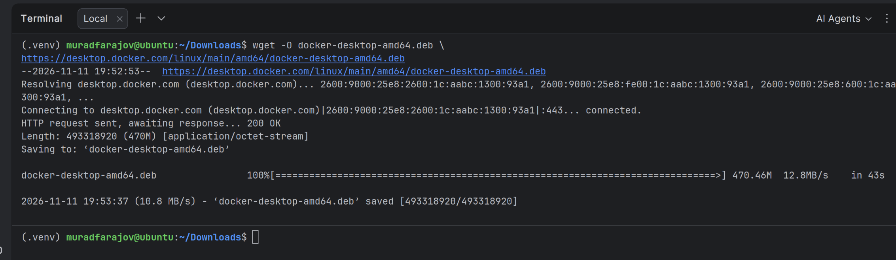


# TASK 1: Cluster prep

## Start Docker Desktop

```bash

systemctl --user start docker-desktop


```

## Docker Desktop Kubernetes cluster is now running

```bash

kubectl config use-context docker-desktop
kubectl config current-context
kubectl get nodes
kubectl cluster-info


```

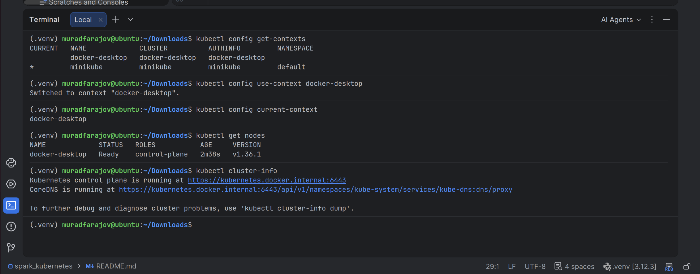


## Creating the Spark namespace

```bash

cd ~/Projects/spark_kubernetes

kubectl create namespace spark-hw

kubectl get namespaces

```

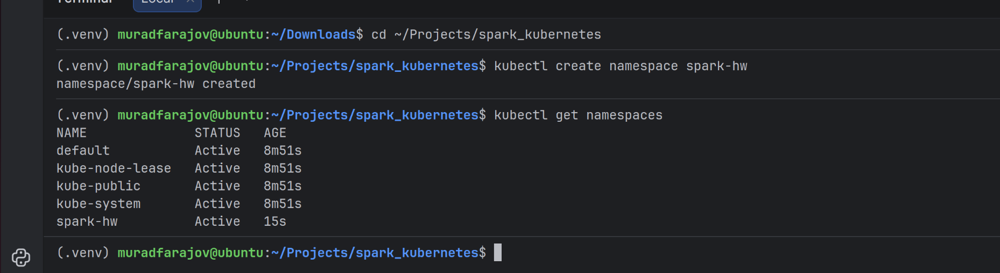


## Create a Spark service account


```bash

kubectl create serviceaccount spark -n spark-hw
kubectl get serviceaccounts -n spark-hw

```

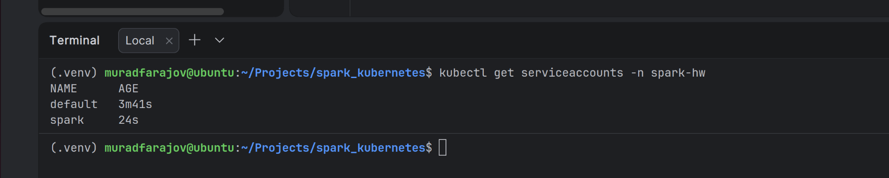


## Configure Kubernetes RBAC

```bash

kubectl create rolebinding spark-edit \
    --clusterrole=edit \
    --serviceaccount=spark-hw:spark \
    -n spark-hw

kubectl get rolebindings -n spark-hw

kubectl auth can-i create pods \
    --as=system:serviceaccount:spark-hw:spark \
    -n spark-hw

kubectl auth can-i create services \
    --as=system:serviceaccount:spark-hw:spark \
    -n spark-hw

```

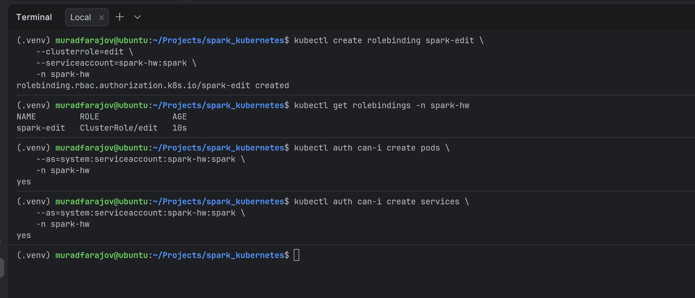


# TASK 2: Build the Spark Docker image (spark-k8s-hw:1.0) using your existing Dockerfile and spark_on_k8s_hw.py.


## spark_on_k8s_hw.py file

```python

import time
from pyspark.sql import SparkSession, functions as F

spark = SparkSession.builder.appName("Spark on K8s HW").getOrCreate()
try:
    df = (spark.range(100000)
          .withColumn("plus_10", F.col("id") + 10)
          .withColumn("double_id", F.col("id") * 2))
    print("=== WEEK 9: FIRST 50 ROWS ===", flush=True)
    df.show(50, truncate=False)
    print("=== STUDENT: MURAD FARAJOV ===", flush=True)
    print("Sleeping for 30 seconds to allow screenshots of executor pods...", flush=True)
    time.sleep(30)
finally:
    print("Stopping SparkSession", flush=True)
    spark.stop()


```


## Dockerfile

```dockerfile

FROM spark:3.5.3-java17
USER root
RUN mkdir -p /opt/spark/work-dir/app
COPY spark_on_k8s_hw.py /opt/spark/work-dir/app/spark_on_k8s_hw.py
RUN chmod a+r /opt/spark/work-dir/app/spark_on_k8s_hw.py
USER spark

```


```bash

docker build -t spark-k8s-hw:1.0 .
docker images spark-k8s-hw

docker run --rm \
    --entrypoint ls \
    spark-k8s-hw:1.0 \
    -l /opt/spark/work-dir/app/
    
```

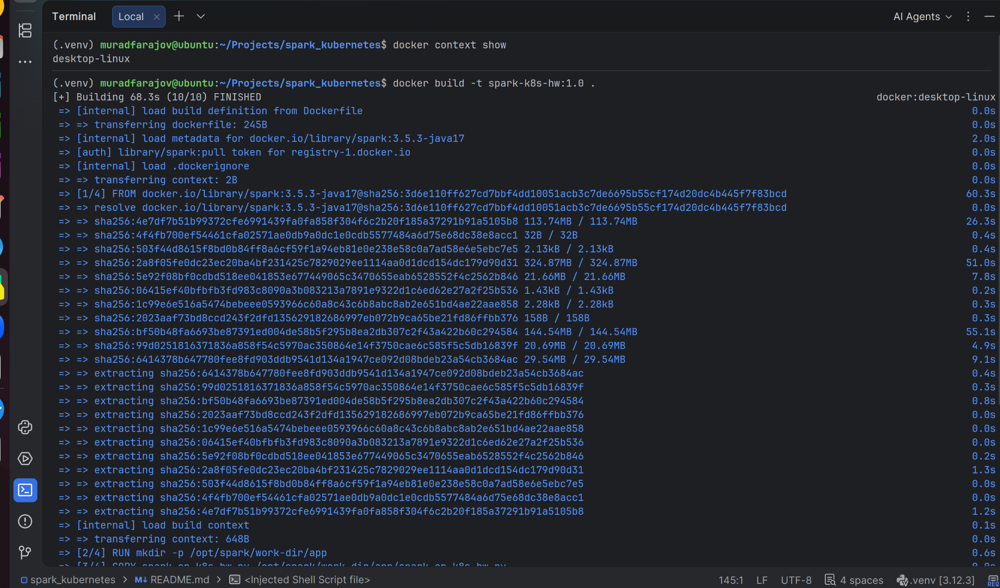

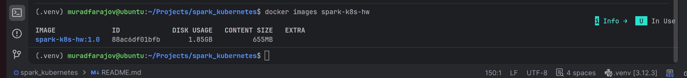

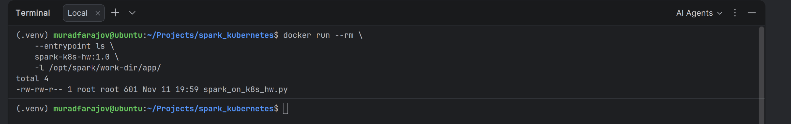


## Download Apache Spark 3.5.3

```bash

cd ~/Downloads
wget https://archive.apache.org/dist/spark/spark-3.5.3/spark-3.5.3-bin-hadoop3.tgz

ls -lh spark-3.5.3-bin-hadoop3.tgz

tar -xzf spark-3.5.3-bin-hadoop3.tgz

ls spark-3.5.3-bin-hadoop3/bin/

```

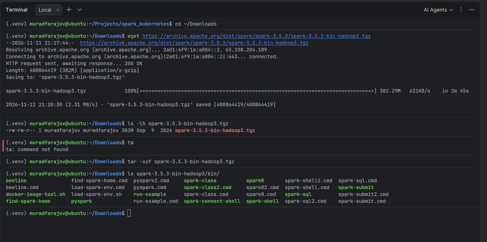


## Install Spark in a permanent directory
```bash

sudo mkdir -p /opt/spark-client
sudo cp -a ~/Downloads/spark-3.5.3-bin-hadoop3/. /opt/spark-client/
ls -l /opt/spark-client/bin/spark-submit

```
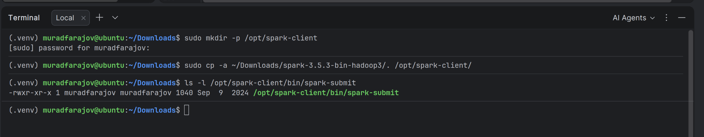


## Configure environment variables

```bash

export SPARK_HOME=/opt/spark-client
export JAVA_HOME=/usr/lib/jvm/java-17-openjdk-amd64
export PATH="$SPARK_HOME/bin:$JAVA_HOME/bin:$PATH"
echo "$SPARK_HOME"
spark-submit --version

```
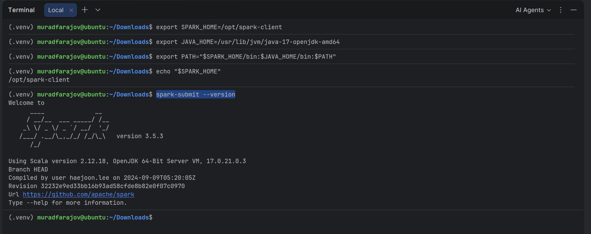


### To make sure the Spark submission process uses the intended Python interpreter

```bash
export PYSPARK_PYTHON=python3
export PYSPARK_DRIVER_PYTHON=python3
```


## Make Spark available in future terminals

```bash

cat >> ~/.bashrc <<'EOF'

# Apache Spark 3.5.3
export SPARK_HOME=/opt/spark-client
export JAVA_HOME=/usr/lib/jvm/java-17-openjdk-amd64
export PATH="$SPARK_HOME/bin:$JAVA_HOME/bin:$PATH"
export PYSPARK_PYTHON=python3
export PYSPARK_DRIVER_PYTHON=python3
EOF

```

# Start Kubernetes proxy

```bash

kubectl proxy --port=8001

```
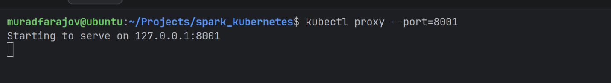


## Open Terminal 2 — Submit your application

```bash

spark-submit \
  --master k8s://http://127.0.0.1:8001 \
  --deploy-mode cluster \
  --name spark-k8s-hw \
  --conf spark.kubernetes.namespace=spark-hw \
  --conf spark.kubernetes.authenticate.driver.serviceAccountName=spark \
  --conf spark.kubernetes.container.image=spark-k8s-hw:1.0 \
  --conf spark.kubernetes.container.image.pullPolicy=Never \
  --conf spark.executor.instances=2 \
  --conf spark.executor.memory=1g \
  --conf spark.executor.cores=1 \
  --conf spark.driver.memory=1g \
  local:///opt/spark/work-dir/app/spark_on_k8s_hw.py

```

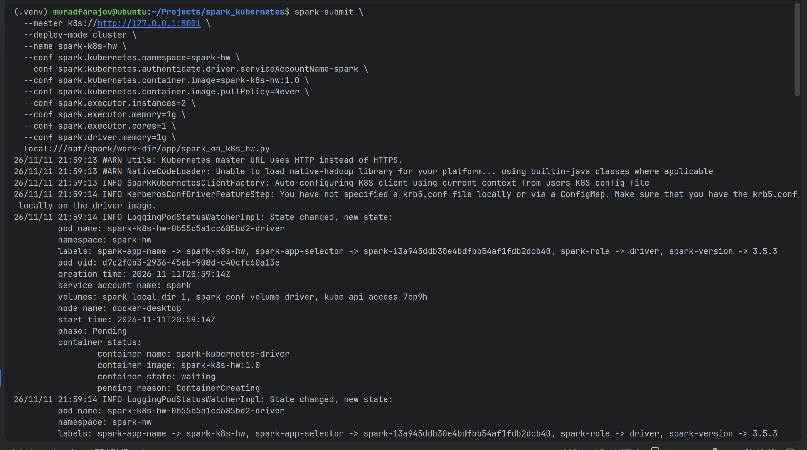


## Open Terminal 3 — Monitor Spark pods

```bash

kubectl get pods -n spark-hw -w

```

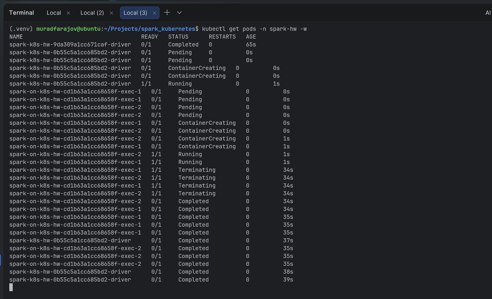


## Verify Spark driver logs

```bash
kubectl get pods -n spark-hw -w
kubectl get pods -n spark-hw

kubectl logs spark-k8s-hw-0b55c5a1cc685bd2-driver \
  -n spark-hw > driver.log

grep -n "MURAD FARAJOV" driver.log

grep -A 55 "FIRST 50 ROWS" driver.log

```

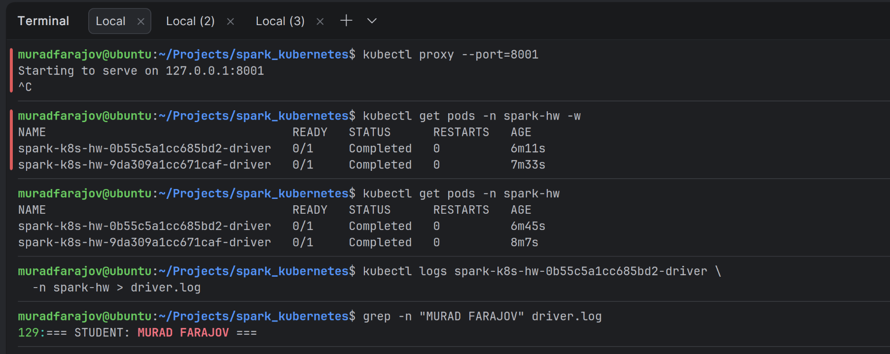

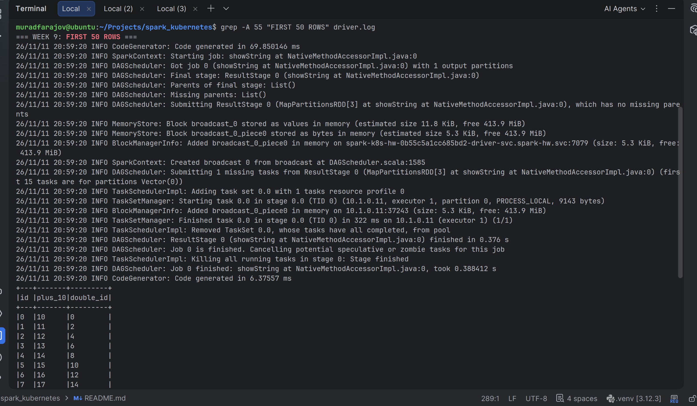


```bash

kubectl logs spark-k8s-hw-0b55c5a1cc685bd2-driver   -n spark-hw | grep -A 5 -B 5 "MURAD FARAJOV"

```

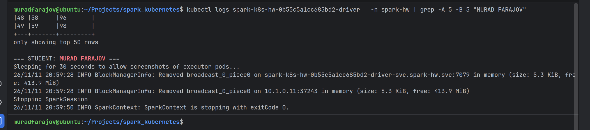


```log
26/11/11 20:59:15 WARN Utils: Kubernetes master URL uses HTTP instead of HTTPS.
26/11/11 20:59:15 WARN NativeCodeLoader: Unable to load native-hadoop library for your platform... using builtin-java classes where applicable
26/11/11 20:59:15 INFO SparkContext: Running Spark version 3.5.3
26/11/11 20:59:15 INFO SparkContext: OS info Linux, 7.0.14-linuxkit, amd64
26/11/11 20:59:15 INFO SparkContext: Java version 17.0.13
26/11/11 20:59:15 INFO ResourceUtils: ==============================================================
26/11/11 20:59:15 INFO ResourceUtils: No custom resources configured for spark.driver.
26/11/11 20:59:15 INFO ResourceUtils: ==============================================================
26/11/11 20:59:15 INFO SparkContext: Submitted application: Spark on K8s HW
26/11/11 20:59:15 INFO ResourceProfile: Default ResourceProfile created, executor resources: Map(cores -> name: cores, amount: 1, script: , vendor: , memory -> name: memory, amount: 1024, script: , vendor: , offHeap -> name: offHeap, amount: 0, script: , vendor: ), task resources: Map(cpus -> name: cpus, amount: 1.0)
26/11/11 20:59:15 INFO ResourceProfile: Limiting resource is cpus at 1 tasks per executor
26/11/11 20:59:15 INFO ResourceProfileManager: Added ResourceProfile id: 0
26/11/11 20:59:15 INFO SecurityManager: Changing view acls to: spark,muradfarajov
26/11/11 20:59:15 INFO SecurityManager: Changing modify acls to: spark,muradfarajov
26/11/11 20:59:15 INFO SecurityManager: Changing view acls groups to: 
26/11/11 20:59:15 INFO SecurityManager: Changing modify acls groups to: 
26/11/11 20:59:15 INFO SecurityManager: SecurityManager: authentication disabled; ui acls disabled; users with view permissions: spark, muradfarajov; groups with view permissions: EMPTY; users with modify permissions: spark, muradfarajov; groups with modify permissions: EMPTY
26/11/11 20:59:16 INFO Utils: Successfully started service 'sparkDriver' on port 7078.
26/11/11 20:59:16 INFO SparkEnv: Registering MapOutputTracker
26/11/11 20:59:16 INFO SparkEnv: Registering BlockManagerMaster
26/11/11 20:59:16 INFO BlockManagerMasterEndpoint: Using org.apache.spark.storage.DefaultTopologyMapper for getting topology information
26/11/11 20:59:16 INFO BlockManagerMasterEndpoint: BlockManagerMasterEndpoint up
26/11/11 20:59:16 INFO SparkEnv: Registering BlockManagerMasterHeartbeat
26/11/11 20:59:16 INFO DiskBlockManager: Created local directory at /var/data/spark-184f7d4c-d6ff-4a14-abef-c895d093e8d7/blockmgr-995a11b2-db2b-4d75-bcea-571a7b50b179
26/11/11 20:59:16 INFO MemoryStore: MemoryStore started with capacity 413.9 MiB
26/11/11 20:59:16 INFO SparkEnv: Registering OutputCommitCoordinator
26/11/11 20:59:16 INFO JettyUtils: Start Jetty 0.0.0.0:4040 for SparkUI
26/11/11 20:59:16 INFO Utils: Successfully started service 'SparkUI' on port 4040.
26/11/11 20:59:16 INFO SparkKubernetesClientFactory: Auto-configuring K8S client using current context from users K8S config file
26/11/11 20:59:16 INFO ExecutorPodsAllocator: Going to request 2 executors from Kubernetes for ResourceProfile Id: 0, target: 2, known: 0, sharedSlotFromPendingPods: 2147483647.
26/11/11 20:59:16 INFO Utils: Successfully started service 'org.apache.spark.network.netty.NettyBlockTransferService' on port 7079.
26/11/11 20:59:16 INFO NettyBlockTransferService: Server created on spark-k8s-hw-0b55c5a1cc685bd2-driver-svc.spark-hw.svc 10.1.0.9:7079
26/11/11 20:59:16 INFO ExecutorPodsAllocator: Found 0 reusable PVCs from 0 PVCs
26/11/11 20:59:16 INFO BlockManager: Using org.apache.spark.storage.RandomBlockReplicationPolicy for block replication policy
26/11/11 20:59:16 INFO BlockManagerMaster: Registering BlockManager BlockManagerId(driver, spark-k8s-hw-0b55c5a1cc685bd2-driver-svc.spark-hw.svc, 7079, None)
26/11/11 20:59:16 INFO BlockManagerMasterEndpoint: Registering block manager spark-k8s-hw-0b55c5a1cc685bd2-driver-svc.spark-hw.svc:7079 with 413.9 MiB RAM, BlockManagerId(driver, spark-k8s-hw-0b55c5a1cc685bd2-driver-svc.spark-hw.svc, 7079, None)
26/11/11 20:59:16 INFO BlockManagerMaster: Registered BlockManager BlockManagerId(driver, spark-k8s-hw-0b55c5a1cc685bd2-driver-svc.spark-hw.svc, 7079, None)
26/11/11 20:59:16 INFO BlockManager: Initialized BlockManager: BlockManagerId(driver, spark-k8s-hw-0b55c5a1cc685bd2-driver-svc.spark-hw.svc, 7079, None)
26/11/11 20:59:16 INFO BasicExecutorFeatureStep: Decommissioning not enabled, skipping shutdown script
26/11/11 20:59:16 INFO BasicExecutorFeatureStep: Decommissioning not enabled, skipping shutdown script
26/11/11 20:59:18 INFO KubernetesClusterSchedulerBackend$KubernetesDriverEndpoint: No executor found for 10.1.0.10:33844
26/11/11 20:59:18 INFO KubernetesClusterSchedulerBackend$KubernetesDriverEndpoint: No executor found for 10.1.0.11:50876
26/11/11 20:59:18 INFO KubernetesClusterSchedulerBackend$KubernetesDriverEndpoint: Registered executor NettyRpcEndpointRef(spark-client://Executor) (10.1.0.11:50880) with ID 1,  ResourceProfileId 0
26/11/11 20:59:18 INFO KubernetesClusterSchedulerBackend$KubernetesDriverEndpoint: Registered executor NettyRpcEndpointRef(spark-client://Executor) (10.1.0.10:33846) with ID 2,  ResourceProfileId 0
26/11/11 20:59:18 INFO BlockManagerMasterEndpoint: Registering block manager 10.1.0.11:37243 with 413.9 MiB RAM, BlockManagerId(1, 10.1.0.11, 37243, None)
26/11/11 20:59:18 INFO BlockManagerMasterEndpoint: Registering block manager 10.1.0.10:40405 with 413.9 MiB RAM, BlockManagerId(2, 10.1.0.10, 40405, None)
26/11/11 20:59:18 INFO KubernetesClusterSchedulerBackend: SchedulerBackend is ready for scheduling beginning after reached minRegisteredResourcesRatio: 0.8
26/11/11 20:59:19 INFO SharedState: Setting hive.metastore.warehouse.dir ('null') to the value of spark.sql.warehouse.dir.
26/11/11 20:59:19 INFO SharedState: Warehouse path is 'file:/opt/spark/work-dir/spark-warehouse'.
=== WEEK 9: FIRST 50 ROWS ===
26/11/11 20:59:20 INFO CodeGenerator: Code generated in 69.850146 ms
26/11/11 20:59:20 INFO SparkContext: Starting job: showString at NativeMethodAccessorImpl.java:0
26/11/11 20:59:20 INFO DAGScheduler: Got job 0 (showString at NativeMethodAccessorImpl.java:0) with 1 output partitions
26/11/11 20:59:20 INFO DAGScheduler: Final stage: ResultStage 0 (showString at NativeMethodAccessorImpl.java:0)
26/11/11 20:59:20 INFO DAGScheduler: Parents of final stage: List()
26/11/11 20:59:20 INFO DAGScheduler: Missing parents: List()
26/11/11 20:59:20 INFO DAGScheduler: Submitting ResultStage 0 (MapPartitionsRDD[3] at showString at NativeMethodAccessorImpl.java:0), which has no missing parents
26/11/11 20:59:20 INFO MemoryStore: Block broadcast_0 stored as values in memory (estimated size 11.8 KiB, free 413.9 MiB)
26/11/11 20:59:20 INFO MemoryStore: Block broadcast_0_piece0 stored as bytes in memory (estimated size 5.3 KiB, free 413.9 MiB)
26/11/11 20:59:20 INFO BlockManagerInfo: Added broadcast_0_piece0 in memory on spark-k8s-hw-0b55c5a1cc685bd2-driver-svc.spark-hw.svc:7079 (size: 5.3 KiB, free: 413.9 MiB)
26/11/11 20:59:20 INFO SparkContext: Created broadcast 0 from broadcast at DAGScheduler.scala:1585
26/11/11 20:59:20 INFO DAGScheduler: Submitting 1 missing tasks from ResultStage 0 (MapPartitionsRDD[3] at showString at NativeMethodAccessorImpl.java:0) (first 15 tasks are for partitions Vector(0))
26/11/11 20:59:20 INFO TaskSchedulerImpl: Adding task set 0.0 with 1 tasks resource profile 0
26/11/11 20:59:20 INFO TaskSetManager: Starting task 0.0 in stage 0.0 (TID 0) (10.1.0.11, executor 1, partition 0, PROCESS_LOCAL, 9143 bytes) 
26/11/11 20:59:20 INFO BlockManagerInfo: Added broadcast_0_piece0 in memory on 10.1.0.11:37243 (size: 5.3 KiB, free: 413.9 MiB)
26/11/11 20:59:20 INFO TaskSetManager: Finished task 0.0 in stage 0.0 (TID 0) in 322 ms on 10.1.0.11 (executor 1) (1/1)
26/11/11 20:59:20 INFO TaskSchedulerImpl: Removed TaskSet 0.0, whose tasks have all completed, from pool 
26/11/11 20:59:20 INFO DAGScheduler: ResultStage 0 (showString at NativeMethodAccessorImpl.java:0) finished in 0.376 s
26/11/11 20:59:20 INFO DAGScheduler: Job 0 is finished. Cancelling potential speculative or zombie tasks for this job
26/11/11 20:59:20 INFO TaskSchedulerImpl: Killing all running tasks in stage 0: Stage finished
26/11/11 20:59:20 INFO DAGScheduler: Job 0 finished: showString at NativeMethodAccessorImpl.java:0, took 0.388412 s
26/11/11 20:59:20 INFO CodeGenerator: Code generated in 6.37557 ms
+---+-------+---------+
|id |plus_10|double_id|
+---+-------+---------+
|0  |10     |0        |
|1  |11     |2        |
|2  |12     |4        |
|3  |13     |6        |
|4  |14     |8        |
|5  |15     |10       |
|6  |16     |12       |
|7  |17     |14       |
|8  |18     |16       |
|9  |19     |18       |
|10 |20     |20       |
|11 |21     |22       |
|12 |22     |24       |
|13 |23     |26       |
|14 |24     |28       |
|15 |25     |30       |
|16 |26     |32       |
|17 |27     |34       |
|18 |28     |36       |
|19 |29     |38       |
|20 |30     |40       |
|21 |31     |42       |
|22 |32     |44       |
|23 |33     |46       |
|24 |34     |48       |
|25 |35     |50       |
|26 |36     |52       |
|27 |37     |54       |
|28 |38     |56       |
|29 |39     |58       |
|30 |40     |60       |
|31 |41     |62       |
|32 |42     |64       |
|33 |43     |66       |
|34 |44     |68       |
|35 |45     |70       |
|36 |46     |72       |
|37 |47     |74       |
|38 |48     |76       |
|39 |49     |78       |
|40 |50     |80       |
|41 |51     |82       |
|42 |52     |84       |
|43 |53     |86       |
|44 |54     |88       |
|45 |55     |90       |
|46 |56     |92       |
|47 |57     |94       |
|48 |58     |96       |
|49 |59     |98       |
+---+-------+---------+
only showing top 50 rows

=== STUDENT: MURAD FARAJOV ===
Sleeping for 30 seconds to allow screenshots of executor pods...
26/11/11 20:59:28 INFO BlockManagerInfo: Removed broadcast_0_piece0 on spark-k8s-hw-0b55c5a1cc685bd2-driver-svc.spark-hw.svc:7079 in memory (size: 5.3 KiB, free: 413.9 MiB)
26/11/11 20:59:28 INFO BlockManagerInfo: Removed broadcast_0_piece0 on 10.1.0.11:37243 in memory (size: 5.3 KiB, free: 413.9 MiB)
Stopping SparkSession
26/11/11 20:59:50 INFO SparkContext: SparkContext is stopping with exitCode 0.
26/11/11 20:59:50 INFO SparkUI: Stopped Spark web UI at http://spark-k8s-hw-0b55c5a1cc685bd2-driver-svc.spark-hw.svc:4040
26/11/11 20:59:50 INFO KubernetesClusterSchedulerBackend: Shutting down all executors
26/11/11 20:59:50 INFO KubernetesClusterSchedulerBackend$KubernetesDriverEndpoint: Asking each executor to shut down
26/11/11 20:59:50 WARN ExecutorPodsWatchSnapshotSource: Kubernetes client has been closed.
26/11/11 20:59:50 INFO MapOutputTrackerMasterEndpoint: MapOutputTrackerMasterEndpoint stopped!
26/11/11 20:59:50 INFO MemoryStore: MemoryStore cleared
26/11/11 20:59:50 INFO BlockManager: BlockManager stopped
26/11/11 20:59:50 INFO BlockManagerMaster: BlockManagerMaster stopped
26/11/11 20:59:50 INFO OutputCommitCoordinator$OutputCommitCoordinatorEndpoint: OutputCommitCoordinator stopped!
26/11/11 20:59:50 INFO SparkContext: Successfully stopped SparkContext
26/11/11 20:59:50 INFO ShutdownHookManager: Shutdown hook called
26/11/11 20:59:50 INFO ShutdownHookManager: Deleting directory /tmp/spark-ecdee765-443b-4016-a58b-3eec47b8eba7
26/11/11 20:59:50 INFO ShutdownHookManager: Deleting directory /var/data/spark-184f7d4c-d6ff-4a14-abef-c895d093e8d7/spark-dbd0fa88-df87-4cb5-8f2e-039bc6877758
26/11/11 20:59:50 INFO ShutdownHookManager: Deleting directory /var/data/spark-184f7d4c-d6ff-4a14-abef-c895d093e8d7/spark-dbd0fa88-df87-4cb5-8f2e-039bc6877758/pyspark-7366a9a0-7542-420c-abff-61b7c0da3f58


```


```bash

cd .. 

zip -r spark_kubernetes_Murad_Farajov.zip spark_kubernetes \
-x "spark_kubernetes/.venv/*"

```

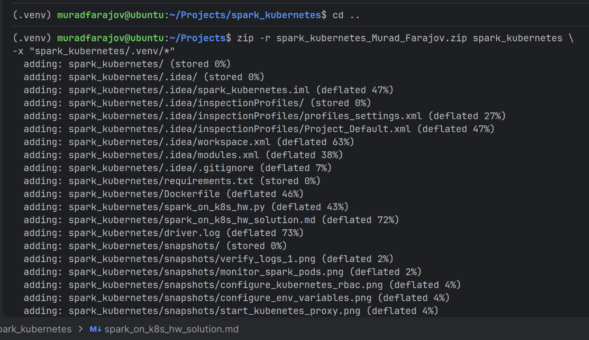
